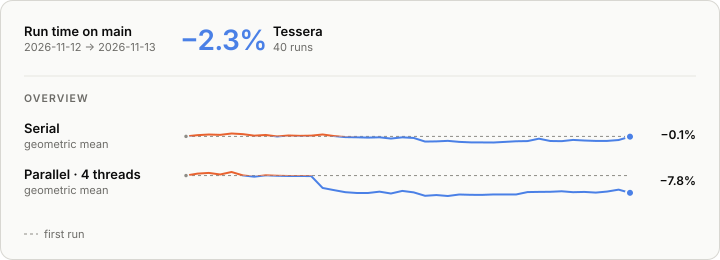

<p align="center">
  
</p>

<h1 align="center">Tessera</h1>

<p align="center">
  <strong>Stable radix sort with O(√n) auxiliary memory.</strong><br>
  Linear time, adaptive to real data, and safe for records that own resources.
</p>

<p align="center">
  <a href="https://github.com/Yikai-Liao/tessera-order/actions/workflows/ci.yml"></a>
  <a href="https://github.com/Yikai-Liao/tessera-order/blob/main/LICENSE"></a>
  
  <a href="https://crates.io/crates/tessera-order"></a>
  <a href="https://docs.rs/tessera-order"></a>
  <a href="https://yikai-liao.github.io/tessera-order/"></a>
</p>

> [!NOTE]
> 0.1 is the first release: the stable sort only, with the API still allowed to change in 0.x minor releases. See the [roadmap](https://github.com/Yikai-Liao/tessera-order/blob/main/ROADMAP.md) for what comes next.

## Why Tessera

An LSD radix sort is stable and runs in linear time, but it needs a second buffer as large as the input. Comparison sorts avoid that buffer and pay O(n log n) comparisons instead. Tessera keeps the radix sort's linear time and stability and bounds the extra memory to O(√n).

- **Stable**, also for descending keys.
- **O(√n) auxiliary memory**, through a stable in-place block partition and a bounded tile buffer.
- **Adaptive.** Sorted, reverse-sorted, nearly sorted and heavily repeated inputs take shortcuts, and constant key bits are skipped.
- **Any record type.** No `Copy`, `Clone`, `Default` or `Ord` needed. Records are moved, never duplicated, even if the key function misbehaves or panics.
- **Wide keys.** Integers up to 128 bits, `f32` and `f64` in `total_cmp` order, and `Reverse<K>`.
- **One portable backend.** Uses `fearless_simd` for vector scans and prefix sums, selecting supported instructions automatically. Requires `std` and Rust 1.89; Rayon is optional.

## Quick start

```toml
[dependencies]
tessera-order = "0.1"
```

SIMD is always enabled; there is no `portable-simd` or `std` feature. Disabling default features does not change the backend or remove the `std` requirement.

```rust
use std::cmp::Reverse;

let mut values: Vec<u64> = vec![42, 7, 19, 7, 3];
tessera_order::sort(&mut values);
assert_eq!(values, [3, 7, 7, 19, 42]);

// Sort records by a key; equal keys keep their input order.
let mut rows = vec![(2u32, "first"), (1, "middle"), (2, "last")];
tessera_order::sort_by_key(&mut rows, |row| Reverse(row.0));
assert_eq!(rows, [(2, "first"), (2, "last"), (1, "middle")]);
```

These examples use the unreleased 0.2 names. The published 0.1 package calls the two sorts `stable_sort` and `stable_sort_by_key`; 0.2 keeps them as deprecated aliases.

| API | Use |
|---|---|
| `sort(&mut [K])` | Sort keys themselves |
| `sort_by_key(&mut [T], F)` | Sort any records by a key computed by `F` |
| `sort_by_cached_key(&mut [T], F)` | Sort by a key evaluated exactly once per record |

The following additions are new in 0.2 and **unreleased**. They require a development checkout as described in the [slice-operation guide](docs/guide/getting-started.md#partial-sorting-and-selected-ranks). Each is the standard operation of the same name, with equal keys resolved as the stable sort resolves them.

| Development API | Use |
|---|---|
| `partial_sort` / `_by_key` | Sort one rank range, partitioning the rest around it |
| `k_smallest`, `k_largest` / `_by_key` | Move the k smallest or largest records to the front, sorted |
| `select_nth` / `_by_key` | Place one ranked record and partition around it |
| `select_nth_many` / `_by_key` | Place several ranked records and partition between them |
| `sort_chunks` / `_by_key` | Sort every fixed-length chunk independently |
| `argsort` / `_by_key` | Return sorted indices without moving source records |
| `partition` | Place predicate matches before nonmatches, keeping input order in both |

The [slice-operation guide](docs/guide/getting-started.md#partial-sorting-and-selected-ranks) and [partition guide](docs/guide/getting-started.md#partitions-and-groups) give examples. [Semantics](conformance/semantics.md#serial-slice-operations) distinguishes mandatory output and request metadata from sorting scratch.

Tessera does not take a comparator: an arbitrary `Ordering` cannot be turned into radix digits.

The optional `rayon` feature adds `par_sort` and `par_sort_by_key` (0.1: `par_stable_sort` and `par_stable_sort_by_key`), requiring `Send` records and a shared `Fn + Sync` key function. Large inputs scatter disjoint root shards in the caller's Rayon pool. Buckets transfer directly into exclusive final bands through a shared source ledger, then sort in their movement tasks. Small inputs and one-thread pools use the serial engine. See [parallel usage](https://github.com/Yikai-Liao/tessera-order/blob/main/docs/guide/getting-started.md#parallel-sorting) and the [parallel contract](https://github.com/Yikai-Liao/tessera-order/blob/main/conformance/semantics.md#rust-rayon-entry-points).

## Performance

Track Rust benchmark trends on the [public Bencher dashboard](https://bencher.dev/perf/yikai-liao-s-project). These continuous measurements flag changes to investigate; use the [benchmark protocol](https://github.com/Yikai-Liao/tessera-order/blob/main/docs/development/benchmarking.md#command-capabilities) for paired algorithm comparisons and source-change attribution.

The [algorithm comparison](https://yikai-liao.github.io/tessera-order/benchmarks/algorithms.html) ranks Tessera among other sorts by speed and extra memory. The preview below tracks Tessera alone on main.

Main trend: the geometric mean of each mode's run-time change since the first run on the current runner specification; lower is faster. The [interactive page](https://yikai-liao.github.io/tessera-order/benchmarks/) filters cases by type, distribution, length and mode, compares cases over any time range and lists absolute times.

[](https://yikai-liao.github.io/tessera-order/benchmarks/)

## When to use something else

- **Orders defined by a comparator**, strings, or other variable-length keys: use `slice::sort_by`.
- **Parallel sorting without the optional `rayon` feature**: Tessera is single-threaded.
- **No allocator**: Tessera needs O(√n) scratch memory, so it cannot run without `alloc` (or, in C++, without a heap).

## Status by language

Each language package is versioned and released separately ([`RELEASING.md`](https://github.com/Yikai-Liao/tessera-order/blob/main/RELEASING.md)).

| Capability | Rust 0.1 | C++ |
|---|---|---|
| Stable sort | Implemented | Planned |
| Unstable sort | Not in 0.1 | Planned |
| 128-bit keys | Signed and unsigned | Planned |
| Records that own resources or hold `&mut` | Supported | Trivially copyable records only (planned) |

A Python binding is planned as well; see the [roadmap](https://github.com/Yikai-Liao/tessera-order/blob/main/ROADMAP.md).

## Learn more

| Topic | Document |
|---|---|
| Ordering, key functions, floats, panics and memory bounds | [`conformance/semantics.md`](https://github.com/Yikai-Liao/tessera-order/blob/main/conformance/semantics.md) |
| How the algorithm works, with interactive figures | [Algorithm explanation](https://yikai-liao.github.io/tessera-order/explain/) |
| How the engine works | [`docs/design/engine.md`](https://github.com/Yikai-Liao/tessera-order/blob/main/docs/design/engine.md) |
| Why user key functions cache bucket IDs | [Record handling](https://github.com/Yikai-Liao/tessera-order/blob/main/docs/design/engine.md#record-handling) |
| All documentation | [Documentation site](https://yikai-liao.github.io/tessera-order/) · [Source index](https://github.com/Yikai-Liao/tessera-order/blob/main/docs/README.md) |

## Contributing

Bug reports, benchmark results from other machines, and integration reports are welcome, and so are AI-assisted contributions, as long as a person has reviewed the change and takes responsibility for it. Please read [`CONTRIBUTING.md`](https://github.com/Yikai-Liao/tessera-order/blob/main/CONTRIBUTING.md) first. Commits are signed off under the [Developer Certificate of Origin](https://developercertificate.org/), and everyone in the project follows the [code of conduct](https://github.com/Yikai-Liao/tessera-order/blob/main/CODE_OF_CONDUCT.md). Report security issues privately as described in [`SECURITY.md`](https://github.com/Yikai-Liao/tessera-order/blob/main/SECURITY.md).

## Acknowledgements

The stable block partition is adapted from Robert Clausecker's [`radixsort_permuted.c`](https://github.com/clausecker/radsort/blob/f69e816c3cd79d312cd67aea5b9cf1c338c1b371/radixsort_permuted.c), described in [*Parallel O(√n) Overhead LSD Radix Sort*](https://arxiv.org/abs/2607.05302) by Robert Clausecker and Florian Schintke. The paper also suggests the hybrid Tessera builds on: splitting on the most significant digit first, then sorting each bucket's remaining digits least significant first.

Tessera was developed and measured with Lukas Bergdoll's [sort-research-rs](https://github.com/Voultapher/sort-research-rs) benchmark harness.

## License

Tessera is licensed under the [BSD 2-Clause License](https://github.com/Yikai-Liao/tessera-order/blob/main/LICENSE). This covers the code adapted from `radixsort_permuted.c`, which is distributed under the same license.
